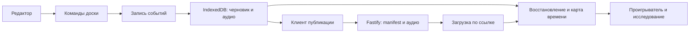

# Replay Board: архитектура

## Статус и границы

До P1 в рабочей папке не было файлов приложения и Git-репозитория.
Git добавлен после доводки P1: ветка main, приватный ReplayBoard на GitHub.
Реализован P1: UI, модель/команды, recorder, восстановление/часы и IndexedDB.
Поверх P1 реализованы живое отображение текста/стрелок и доводка интерфейса студии.
Ниже описан дизайн всей первой версии; audio/story/timeline/publishing/server относятся к следующим этапам.
Требования: [PRODUCT.md](PRODUCT.md). Причины выбора: [agent/DECISIONS.md](agent/DECISIONS.md).

## Выбранный стек

| Область | Выбор | Назначение |
| --- | --- | --- |
| UI | React + TypeScript | Редактор, проигрыватель, доступные панели и состояния |
| Сборка | Vite 8 | SPA и быстрый цикл работы над frontend |
| Доска | SVG + Pointer Events + CSS | Объекты, подписи, связи, камера и взаимодействие |
| Локальные данные | Dexie поверх IndexedDB | Транзакционные черновики, события и бинарное аудио |
| Голос | getUserMedia, MediaRecorder, HTMLMediaElement | Опциональная запись и воспроизведение |
| Сервер | Node.js 24 + Fastify 5 | Валидация и публикация файловых пакетов |
| Проверки | Vitest, Playwright, TypeScript, ESLint | Доменная логика, интеграция и браузерные сценарии |
| Внешний вид | CSS variables, локальные шрифты с кириллицей | Согласованная светлая студия без зависимости от CDN |

Начальный выбор шрифтов: Golos Text для интерфейса и Manrope для коротких заголовков;
проверить кириллицу, начертания и фактическую компоновку на P1.
SSR не нужен для локального редактора. Серверная публикация отделена от браузерной модели.
Точные версии зависимостей будут закреплены после разрешения совместимого набора на P1.

Документация проверена через Context7 24.11.2026:

- [Vite: Getting Started](https://vite.dev/guide/) — требования Node 20.19+/22.12+; Node 24 подходит.
- [Fastify: LTS](https://fastify.dev/docs/latest/Reference/LTS/) — Fastify 5 поддерживает Node 24.
- [Fastify: Validation and Serialization](https://fastify.dev/docs/latest/Reference/Validation-and-Serialization/) —
  полные JSON Schema для входных данных и ответов.
- [Dexie: Best Practices](https://dexie.org/docs/Tutorial/Best-Practices) —
  не ожидать fetch, таймеры и другие внешние async операции внутри IndexedDB-транзакций.

Это проверка документации, а не установленного приложения.
Перед реализацией браузерных API, React, Vitest и Playwright сверить нужные сигнатуры с актуальными документами.

## Компоненты и поток данных

Планируемые границы модулей:

| Путь от корня | Ответственность |
| --- | --- |
| `src/domain/` | Формат проекта, объекты, команды, чистый reducer и runtime-валидация |
| `src/recording/` | Сессия записи, активные часы, события, checkpoints |
| `src/playback/` | Восстановление, транспорт и координация часов |
| `src/audio/` | Устройство, кодек, аудиофрагменты, воспроизведение и освобождение ресурсов |
| `src/story/` | Главы, пояснения, вопросы и дерево продолжений |
| `src/timeline/` | Неразрушающий монтаж и отображение времени |
| `src/storage/` | IndexedDB, автосохранение, миграции и восстановление |
| `src/publishing/` | Сборка пакета и клиент серверного API |
| `src/features/`, `src/components/`, `src/styles/` | Экраны, доска, панели и дизайн-токены |
| `server/` | Валидация, файловое хранилище и выдача публикаций |
| `tests/e2e/` | Сквозные сценарии и проверки браузера |

Фактическая точка входа — `src/main.tsx`; маршруты — `src/app/App.tsx`.
В P1 существуют domain/recording/playback/storage, редактор/проигрыватель/стартовый экран,
компоненты SVG-доски и E2E. Остальные строки таблицы остаются планом.

## Модель доски и формат

Планируемый `Project`: `formatVersion`, `projectId`, `revision`, название,
время изменения, рабочая доска, `rootSegmentId`, сегменты истории и ссылки на аудио.
Начальная версия формата — 1; версия базы IndexedDB управляется отдельно.

`BoardState` содержит объекты со стабильными ID, порядком отрисовки, координатами,
размерами, текстом и стилем. Связь хранит `sourceId`, `targetId` и стороны подключения.
SVG-геометрия вычисляется из объектов: движения и resize не порождают рассинхроненных копий стрелки.
Удаление узла и инцидентных связей выполняется одной доменной командой; undo возвращает весь результат.
Текст хранится и показывается как текст, без исполнения произвольного HTML.

`FrameState` включает доску, камеру, выделение и указатель.
Камера P1 хранит `x/y/zoom` и необязательные `viewportWidth/viewportHeight`.
Запись фиксирует рабочую область автора; desktop переносит её в viewport зрителя.
Компактный проигрыватель фокусируется на текущем записанном объекте/связи и сохраняет читаемость.
Ручное исследование остаётся отдельным состоянием; resume возвращает проекцию исходного кадра.
UI-настройки панелей и временное состояние перетаскивания находятся вне проектного формата.
Drag/resize используют координаты доски; привязка выдаёт те же команды, что обычное перемещение.
Undo/redo редактора преобразуется в новые записываемые изменения, сохраняя порядок объяснения.

`StorySegment`: ID, начальный FrameState, длительность, события, checkpoints,
главы, текстовые пояснения, аудиоклипы, список сохранённых интервалов и необязательная развилка.
У сегмента ровно один родитель, кроме корня.

`RecordedEvent`: ID, ID сегмента, `tMs`, `seq`, тип и полезные данные.
Типы включают создание/изменение/удаление объекта, выделение, камеру, указатель и `StateRebased`.
Изменения геометрии хранят конечные значения полей, не зависят от накопления render-delta.
Получение ID и времени происходит вне чистого reducer.

## Время, паузы и детерминизм

1. Часы записи монотонны и накапливают только активные интервалы.
   Отсчёт основан на performance.now; в сохранённом формате время — целые миллисекунды.
2. `seq` разрешает одинаковые временные метки. Восстановление применяет события
   в порядке `(tMs, seq)`; случайность и обращение к устройствам запрещены внутри reducer.
3. При паузе поток событий и активные часы остановлены. Редактирование рабочей доски разрешено.
   При продолжении событие `StateRebased` на текущем активном времени фиксирует новое состояние.
   Последовательность до этой точки остаётся неизменной.
4. Checkpoint хранит полный FrameState и точный курсор событий, включая `seq`.
   Начальная стратегия — каждые 5 секунд активного времени или 100 событий;
   частоту уточнить после измерения объёма/времени seek на P2.
5. Seek выбирает ближайший checkpoint не позже нужной позиции и применяет его суффикс.
   Объекты, удалённые в прошлом, не восстанавливаются из текущего UI-состояния.
6. Указатель записывается с ограниченной частотой; последний sample сохраняется.
   Интерполяция указателя/камеры — чистая функция времени и не меняет доменные события.
7. Исследование зрителя хранит отдельное view-состояние. Продолжение заново получает
   каноническое состояние, камеру и время автора из engine.

Состояния транспорта: `idle`, `recording`, `paused`, `stopping`;
у проигрывателя отдельно `playing`, `paused`, `awaitingChoice`, `ended`, `error`.
Ошибка сохранения относится к storage и не маскируется успешным состоянием транспорта.

## Реализованный слой отображения P1

`src/playback/presentation.ts` готовит индекс эффектов один раз на RecordingSegment.
`PlaybackPresentation.at(positionMs, reducedMotion)` возвращает канонический FrameState
из `reconstruct` и отдельные проекции текста/связей. Формат 1 и данные IndexedDB не меняются.
Проекция не записывает промежуточный текст или путь обратно в команды.

Реальные одиночные клавиши отображаются в момент события, включая одинаковые tMs
с последовательными seq. Вставки и исправления сравниваются по Unicode-графемам;
раскладка удерживает невидимый остаток полного текста. Курсор вычисляется из времени
истории. Эффект ограничен следующим изменением объекта и концом сегмента.
Стрелка строится частичной кривой Bézier по текущим границам связанных объектов;
маркер завершения появляется у конца нарисованного пути.

Пауза, seek и скорость используют одну позицию PlaybackClock. При уменьшенном
движении отображается полная каноническая команда. На компактном экране focusId
берётся из выделения автора либо последнего изменения текста/связи; пользовательская
камера исследования остаётся отдельной. Выбор отступа инструментов при fit использует
тот же viewport breakpoint, что их CSS-ориентация.

## Голос и часы воспроизведения

`AudioCapture` запрашивает getUserMedia только после включения голоса автором.
Без голоса запись доски использует тот же recorder. Отказ и потеря устройства отключают
аудио с понятным состоянием; записанные действия остаются доступными.
Завершение/уход из записи останавливает MediaRecorder и каждый MediaStreamTrack,
сохраняет финальные данные и освобождает временные object URLs.

MIME выбирается проверкой поддержки среды; контейнер и фактическая длительность сохраняются.
Непрерывные участки голоса оформляются как AudioClip со временем начала в сегменте.
Пауза закрывает активный клип; продолжение начинает следующий, поэтому пауза не попадает в готовый голос.
Пока клип активен, dataavailable-порции сохраняются с ID и порядком.

Координатор сопоставляет активное время записи, границы аудиоклипов и измеренную длительность медиа.
Стартовый сдвиг устройства и асинхронный stop не считаются автоматически нулевыми.
При наличии активного клипа источник playback-времени — media.currentTime;
между клипами и без голоса используются монотонные часы с опорной позицией и скоростью.
Play/pause, seek и rate применяются к одному выбранному месту source timeline.
После seek требуется подтверждённое позиционирование медиа перед возобновлением.

Восстановление незавершённого аудиоконтейнера проверяется на P3:
порции MediaRecorder не предполагаются самостоятельными проигрываемыми файлами.
Адаптер должен собрать и проверить подтверждённый префикс после reload.
Если выбранный MIME не обеспечивает восстановление, до приёмки P3 требуется
адаптер сохраняемых PCM-порций с формированием WAV либо корректная сборка контейнера.
Непроверяемый аудиопрефикс не считается восстановленным голосом.

## Главы, монтаж и ветки

Главы и текстовые пояснения привязаны к исходному времени сегмента.
Название главы редактируется независимо от исходных событий.
Монтаж — упорядоченный список сохраняемых интервалов `[sourceStartMs, sourceEndMs)`.
Engine преобразует время результата в исходное время через одну карту для доски, аудио, глав и вопросов.
Позиция на самом конце сегмента обрабатывается явно, включая его финальное состояние.

При trim начала новый старт вычисляется восстановлением исходной доски.
При пропуске внутреннего интервала engine восстанавливает состояние на его правой границе,
а не просто игнорирует все команды удалённого времени.
Аудио читается из соответствующего исходного диапазона, без обязательного транскодирования.
На границах cut проверить точность media-seek и слышимые артефакты; критерий P4 включает эти переходы.

Развилка хранит вопрос, время и варианты с ID дочерних сегментов.
Доска и голос останавливаются в точке вопроса. Child.initialState копирует каноническое
состояние родителя в этой точке; запись продолжения идёт со своего нулевого времени.
В выбранном пути родитель завершается у вопроса; его последующие исходные события не выполняются.
Хвост исходной записи сохраняется в черновике; продолжения содержат собственные события.
Возврат к вопросу восстанавливает родителя и исключает состояние уже просмотренного ребёнка.
Проверка формата запрещает циклы, отсутствующие дети и несогласованные начальные состояния.

Trim может скрыть вопрос; его продолжения остаются в исходном черновике,
а опубликованный результат включает только достижимое дерево.
Сокращение «паузы», пересекающей активную точку вопроса, отклоняется с объяснением;
автор может изменить границы интервала. Исходная запись сохраняется.

## Локальное хранение

Планируемые таблицы Dexie: `projects`, `segments`, `eventBatches`, `checkpoints`,
`audioChunks`, `audioAssets`. Связи данных и ревизия проекта обновляются транзакционно.
В P1 база версии 1 содержит `projects`: целый документ проекта с рабочим FrameState и segments.
Разделение на таблицы/порции потребуется при добавлении checkpoints/аудио и после измерения объёма.
Транзакции выполняют только IndexedDB-операции; кодирование аудио и публикационный fetch — снаружи.

Автосохранение сериализует обновления одного проекта, группирует частые события и
фиксирует границу подтверждённых данных. Проверяются stop, пауза, продолжение и reload.
В P1 таймер стартует от первой несохранённой правки и не переносится последующими событиями;
интервал до начала commit — 250 мс, heartbeat записи — 1 секунда.
Каждый writer передаёт последнюю подтверждённую ревизию; transaction проверяет её атомарно.
После успеха writer обновляет базу следующего commit. Конфликт не заменяет свежий документ.
Undo/redo восстанавливают доску/выделение и сохраняют текущие камеру, viewport и указатель.
Нельзя рассчитывать на завершение async-сохранения в beforeunload.
Незавершённая запись восстанавливается из последней успешной ревизии и аудиопорций
с сообщением о прерывании; несохранённый хвост не объявляется сохранённым.

StorageStatus: `dirty`, `saving`, `saved`, `error`, `recovering`.
Quota/ошибка транзакции сохраняет рабочие данные в памяти, показывает причину и повтор.
Миграции базы и формат проекта проверяются отдельно; несовместимый формат не перезаписывается.

## Серверная публикация и доступ

Для разработки выбран один Fastify-процесс и файловое хранилище.
Черновики остаются в браузере. Готовая публикация — неизменяемый manifest
с версией формата и собственными аудиофайлами; локальные object URLs заменяются asset ID.

Планируемый контракт:

| Запрос | Результат |
| --- | --- |
| `POST /api/publications` | Multipart manifest + аудио; 201 с ID и ссылкой после завершения хранения |
| `GET /api/publications/:id` | Проверенный manifest опубликованной истории |
| `GET /api/publications/:id/audio/:assetId` | Медиа с поддержкой диапазонов для перемотки |
| `GET /s/:id` | SPA-проигрыватель; прямое открытие и reload поддерживаются |

Сервер проверяет полную JSON Schema, версию, ссылки, дерево, интервалы, конечность чисел,
размеры данных и наличие аудио. Файлы пишутся в staging, проверяются и атомарно становятся
видимыми как пакет. Ссылка не возвращается раньше успешного завершения.
Пути формируются сервером из проверенных ID; пользовательские пути файлов не принимаются.
Бинарные данные передаются потоком; ограничения объёма задать и показать в UI на P6.
Повтор запроса после ошибки не создаёт ложную локальную отметку «Опубликовано».

Vite dev-server проксирует API; проигрыватель читает remote manifest через отдельный loader.
Для приёмки локальные таблицы нового браузерного контекста пусты.
Проверяется сохранность файлов после перезапуска backend.
Приложение не требует Docker, облака, Supabase или внешней БД.

Планируемые переменные: `REPLAY_STORAGE_DIR`, `PUBLIC_BASE_URL`, `MAX_PUBLISH_BYTES`;
при раздельных origin может понадобиться `VITE_API_BASE_URL`.
Они пока не настроены. Локальный сервер по умолчанию слушает loopback.
Авторизация и внешнее размещение не нужны для локальной приёмки;
публичное размещение потребует отдельного решения о доступе, хранилище и лимитах.

## Проверки и развитие

Чистые тесты: reducer, временной порядок, undo/redo, rebase на паузе, checkpoints,
seek через удаления, карта монтажа и дерево.
Интеграционные: транзакции, восстановление записи/аудио, загрузка полного пакета,
ошибки хранения и повторное открытие.
Браузерные: настоящий пользовательский путь, микрофон/отказ, транспорт, cut,
ответы, публикация в чистом контексте, desktop/mobile и reduced motion.

Основные риски: MIME/seek и восстановление аудио, точность стыков после монтажа,
квота IndexedDB, объём высокочастотных событий и качество взаимодействия с SVG.
Риски проверяются на соответствующих этапах, а не объявляются решёнными выбором библиотек.
Renderer, storage и publication — сменяемые адаптеры; новые решения не меняют сущность истории.
